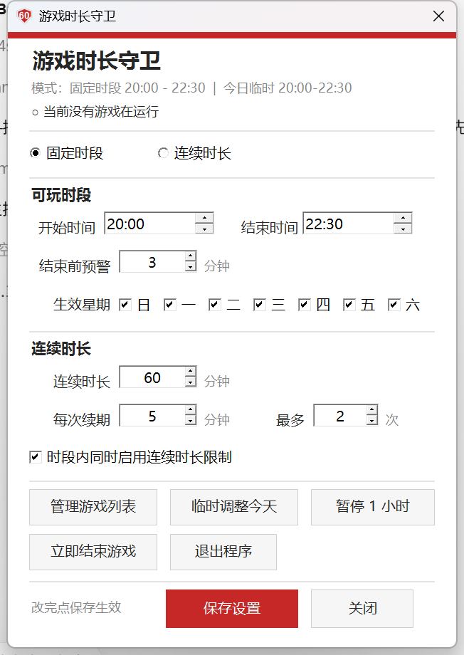

# GameGuard · 游戏时长守卫

一个轻量的 Windows 托盘工具：帮自我管理（或家长与孩子约定）控制游戏时长。
到点弹窗提醒，可选择结束游戏或续期；也支持固定可玩时段，到点自动收尾。

> 不是防沉迷系统，也不做偷偷监控——它只是一个「说到做到」的计时器，建议安装前与使用的人明确约定。




## 功能特性

- **三种模式，独立运行或自由叠加**
  - **固定时段**：每天指定时间窗（如 20:00–22:30）+ 生效星期；时段外启动游戏会提示并自动关闭；结束前 N 分钟弹窗预警
  - **连续时长**：游戏连续运行 N 分钟后弹窗，可选「再玩 M 分钟」（次数可限）或「结束游戏」；60 秒无操作自动结束
  - **每日配额**：每天累计最多玩 X 分钟，何时玩随意；临近用完预警，用完弹窗可选续期（次数可限）；已用时长跨重启保留，每天零点自动重置
  - **可任意组合**：例如「时段 + 配额」= 只能在时段内玩且总量受限；「时段 + 连续 + 配额」三重约束；续期会同时延长轮次与配额；至少启用一种模式
- **左键托盘图标 = 控制面板**：模式、时段、预警、续期次数、游戏列表全部在一个窗口内修改，保存即时生效
- **多游戏管理**：自动扫描 Steam 库（多库目录、按常见目录结构定位主程序），也支持手动添加任意 exe
- **看门狗自愈**：`install.bat` 会注册一个每分钟检查的计划任务——GameGuard.exe 被结束或崩溃后 1 分钟内自动拉起；正常退出会自动暂停看门狗，下次启动恢复
- **配置防篡改**：config.json 带校验和（config.sum）与自动备份（config.bak.json），启动时发现被手改会自动恢复最近一次合法配置；无备份时重置默认（原文件留存为 config.json.bad）。修改设置请走控制面板
- **使用记录防删改**：usage.csv 采用链式校验（usage.sum）+ 镜像备份（usage.bak.csv），被删改后自动恢复；无法恢复时重新开始记录并留档
- **用量统计**：按天记录游玩时长（`usage.csv`，本地文件不上传），多游戏并行运行时时间均摊归因；托盘菜单或面板「本周统计」可看近 7 天柱状图、每个游戏的合计与今日时长
- **临时调整今天**：仅当天生效的时段 / 配额覆盖，次日自动恢复
- **挂机也算时间**：按进程计时，而非窗口焦点
- **DPI 自适应**：100%–150% 缩放下界面均正常
- **绿色单文件**：一个 exe + config.json，无安装、无后台服务、不上传任何数据

## 安装

### 方式一：下载 Release（推荐）

1. 从 [Releases](../../releases) 下载 `GameGuard-x.x.x.zip` 并解压到任意目录（如 `C:\GameGuard`）
2. 双击 `GameGuard.exe`，托盘出现红色盾牌图标
3. 如需开机自启：双击 `install.bat`（会复制启动脚本到「启动」文件夹）；卸载用 `uninstall.bat`

> 首次运行若出现「Windows 已保护你的电脑」，点「更多信息 → 仍要运行」。本项目开源且不签名，此警告属正常。

### 方式二：从源码编译

需要 Windows 10+ 与系统自带的 .NET Framework 4 编译器（无需安装任何 SDK）：

```bat
git clone https://github.com/Ruan-shi/GameGuard.git
cd GameGuard
build.bat
```

## 使用说明

- **左键单击**托盘盾牌图标 → 打开控制面板，修改后点「保存设置」
- **右键图标** → 快捷菜单：切换模式、临时调整今天、暂停 1 小时、立即结束游戏、退出
- 全部配置保存在 exe 同目录的 `config.json`，可直接编辑或备份

### config.json 主要字段

| 字段 | 说明 | 默认 |
|---|---|---|
| `games` | 受管控游戏列表（name / processes / pathFilter） | — |
| `useSchedule` | 启用固定时段模式 | true |
| `useContinuous` | 启用连续时长模式（单独启用=轮次模式，配合时段=叠加轮次限制） | false |
| `useQuota` | 启用每日配额模式 | false |
| `mode` | 旧版三态字段（v1.1 兼容保留，新配置以上面三个开关为准） | — |
| `quotaMinutes` | 每日配额总时长（分钟） | 120 |
| `quotaWarnMin` | 配额临近用完预警分钟数 | 10 |
| `quotaDate` / `quotaUsedSec` / `quotaExtraSec` | 配额运行状态（已用时长持久化，防重启绕过），自动维护 | — |
| `scheduleStart` / `scheduleEnd` | 可玩时段（HH:mm，支持跨零点） | 18:00 / 20:00 |
| `scheduleDays` | 生效星期，0=周日…6=周六，空数组=每天 | 每天 |
| `scheduleWarnMin` | 结束前预警分钟数 | 3 |
| `scheduleWithContinuous` | 时段内是否叠加连续时长规则 | true |
| `playMinutes` | 单轮连续时长（分钟） | 60 |
| `extendMinutes` / `maxExtend` | 每次续期 / 最多续期次数 | 5 / 2 |
| `outsideCountdown` | 时段外提示后多少秒关闭游戏 | 5 |

## 常见问题

**Q：弹窗会不会被全屏游戏压住？**
检测到独占全屏时会先最小化游戏再弹窗（结束后若选择续期会自动还原）。更稳的做法是把游戏设为「无边框窗口/窗口化全屏」。

**Q：家长装给孩子，会被孩子改掉配置吗？**
配置文件带校验和与自动备份：手改 config.json 会在下次启动时被检测到并自动恢复为最近一次合法配置（无备份时重置为默认）。修改设置请通过控制面板；本工具定位仍是「约定执行器」，校验和防的是临时起意，不是对抗高手。

**Q：支持 Epic / WeGame 游戏吗？**
支持手动添加：在「管理游戏列表 → 手动添加」里填进程名（任务管理器 → 详细信息 里查看）。

**Q：退出软件会丢管控吗？**
会。退出有二次确认，且下次开机自动恢复（装过 install.bat 的话）。

## 项目结构

```
GameGuardApp.cs     主程序（C# / WinForms，单文件）
build.bat           一键编译 + 更新自启动
make-release.bat    编译并打包发布 zip 到 dist/
GameGuard.ps1       旧版 PowerShell 实现（已由 C# 版取代，保留供参考）
docs/               截图与文档
```

## 许可证

[MIT](LICENSE) © 2026
